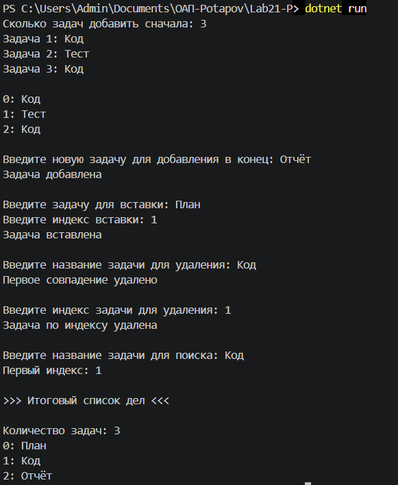

# Практическая работа №21

Автор: Потапов Даниил 
Группа: ИСП-252

## Тема

Коллекция List в C#.

## Что реализовано

- ввод и вывод списка задач;
- добавление и вставка;
- удаление по значению и индексу;
- поиск первого совпадения;
- проверка допустимости индексов;
- обработка пустого списка.

## Короткие ответы

1. Чем List отличается от массива и как узнать количество элементов списка?

Ответ: У массива размер фиксируется при создании, а `List<T>` может динамически расти и уменьшаться при добавлении или удалении элементов. Узнать количество элементов в списке можно через свойство `Count`

2. Чем отличаются Remove() и RemoveAt()?

Ответ: Метод `Remove(значение)` ищет и удаляет первое совпадение по самому значению элемента, а `RemoveAt()` удаляет элемент по его порядковому номеру

3. Почему для вставки допустим индекс Count, а для удаления — нет?

Ответ: Индекс `Count` указывает на позицию сразу после последнего элемента, поэтому туда можно вставить новый элемент в конец списка. При удалении по индексу `Count` обращаться не к чему, так как последний существующий элемент имеет индекс `Count - 1`

## Результат

